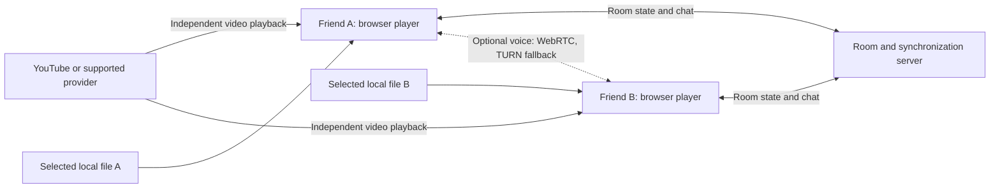

# Watch Together — Product Requirements Document

Version: 1.0 · Research date: 14 October 2026 · Status: proposed product plan

This document is a standalone planning artifact. It does not assume an existing implementation. Findings come from public primary documentation; no provider integration, signed-in playback, or network prototype was tested. Product choices, thresholds, estimates, and architecture below are proposals to validate, not measured results.

## 1. Product decision

Build a private watch room where two friends in different places watch the same content, pause and seek together, and talk or react while watching.

Recommended release sequence:

1. Website: YouTube videos that permit embedding and matching local, unprotected video files on both computers.
2. Website improvements: optional two-person voice, additional supported public players, and direct media URLs.
3. Separate desktop browser extension: investigate Netflix first, then other subscription providers individually.
4. Optional media delivery: sharing a user-owned local video when only one viewer has it, if demand justifies the added complexity.

The product must name supported sources explicitly. “Watch any show from any site” is not an achievable promise for a universal standalone website.

The central design choice is independent playback: each viewer obtains video from the provider or their own computer; our service exchanges room state, playback commands, and chat. This keeps original playback quality and avoids carrying movie-sized traffic through our backend. Sending one person's video to the other is a separate mode with different infrastructure and rights requirements.

## 2. Users, problem, and success

Primary user: two friends, partners, or family members on separate internet connections who want a shared evening without repeatedly counting down, comparing timestamps, or telling each other to pause.

Core job: “Let me invite my friend, start the same video, and feel that we are watching it together.”

Proposed starting assumptions: private rooms, two participants, desktop Chrome and Edge first, guest nicknames, no required app account, no paid subscription to our product during validation. Mobile layout is desirable; mobile playback support is a separate tested capability. Larger groups and TV support come later.

Success means easy room entry, clear readiness, predictable shared controls, recovery after interruptions, and enough social presence to make the experience feel shared.

Pilot targets, to be validated:

- At least 90% of supported-source test pairs reach shared playback without developer help.
- Median room entry to readiness under 60 seconds for YouTube, excluding time spent selecting a video.
- At least 95% of eligible steady-playback measurements have pairwise drift below 500 ms for matching local files and below 1 second for YouTube.
- Shared pause/seek reflected within 1 second at the 95th percentile under the supported network test conditions.
- At least 8 of 10 pilot pairs finish a 30-minute session without restarting the room.
- Track repeat sessions within seven days; establish a baseline before setting a retention target.

Eligible measurements exclude ads, buffering, blocked autoplay, and disconnection, but these interruptions must be reported separately. Excluding them must never conceal a poor experience.

## 3. Source feasibility

| Source or scenario | Standalone website | Additional requirement | Release decision |
|---|---|---|---|
| YouTube on-demand video with embedding enabled | Feasible through official embedded player | Both viewers must be able to play that video | MVP |
| Private, age-restricted, region-restricted, deleted, or embedding-disabled YouTube video | Not universally supported | Provider access and restrictions still apply | Show a clear source error |
| Matching unprotected local files on both computers | Feasible with file selection and browser video playback | Same playable file on each computer | MVP |
| Only host has the local file | Not solved by synchronization alone | File transfer, hosted delivery, or live media transport | Deferred |
| Direct HTTPS MP4/WebM media URL | Conditionally feasible | Accessible, seekable, browser-supported media with permission to use it | Later adapter |
| Vimeo | Feasible candidate through official player SDK | Embed privacy and access settings allow it | Later adapter |
| Arbitrary public webpage containing a video | No general website-only support | Documented player API or a tested extension adapter | Explicitly unsupported by default |
| Netflix | Do not promise an embedded website player | Provider-page extension experiment; valid access per viewer | Later conditional phase |
| Prime Video, Disney+, Max, Hulu, JioHotstar and other subscription services | No generic integration promise | Separate technical and policy assessment for each service/region | Backlog candidates |
| Offline downloads inside subscription apps | Outside local-file support | App-specific protected playback, not an ordinary imported media file | Excluded |
| Unprotected screen sharing | Technically possible candidate | Capture permission, audio support, WebRTC and rights to share | Optional future mode |
| Protected subscription video screen sharing | Unreliable product foundation | Content protection and provider restrictions | Excluded as a supported delivery method |

### YouTube

The official IFrame Player API supplies playback controls, seeking, time queries and state events. It also documents errors for disabled embedding and missing client identification. Use it instead of extracting video URLs. [YouTube IFrame API](https://developers.google.com/youtube/iframe_api_reference)

Preserve player branding, controls, ads and attribution. Do not download or strip video/audio, or build ad blocking. Maintain the required referrer identification and keep app chat/reactions outside the player area. [Developer policies](https://developers.google.com/youtube/terms/developer-policies), [embedded-player requirements](https://developers.google.com/youtube/terms/required-minimum-functionality)

Ads are a material limitation. Inference from the documented API surface: it does not provide a general documented ad lifecycle suitable for guaranteeing identical ad timing between viewers. Do not claim perfect synchronization through ads. Provide “wait for my friend” and manual resync, investigate safe automatic recovery after normal playback resumes, and never seek or repeatedly issue commands to evade an advertisement. The spike must determine whether the ad experience is acceptable.

### Local files

A website can read files explicitly selected by the user and create local object URLs. Selection does not upload or distribute the file. [MDN File API](https://developer.mozilla.org/en-US/docs/Web/API/File_API/Using_files_from_web_applications)

Each viewer selects their copy. Browser playback supports time and rate controls, but playable formats depend on codecs and the environment; an MP4 extension alone is not sufficient. Test MP4 with H.264/AAC and WebM samples, show unsupported-format errors, and avoid promising universal MKV/HEVC support. [HTMLMediaElement](https://developer.mozilla.org/en-US/docs/Web/API/HTMLMediaElement), [HTML video](https://developer.mozilla.org/en-US/docs/Web/HTML/Reference/Elements/video)

Proposed MVP identity rule: require identical file bytes, verified by a full hash computed locally in chunks. Exchange only a room-scoped digest plus size and duration; do not transmit file contents or paths. Show hashing progress and allow cancellation. Duration and size are early mismatch checks, not proof of equality. Matching different encodes or different cuts is a future feature. Never enable shared start while file identity is unresolved.

When only the host has the file, choices are: transfer a permitted copy first, host an authorized copy behind controlled access, or stream the host's playback. These are engineering alternatives, not permission to distribute copyrighted material. Start with user-owned or otherwise authorized content.

### Netflix and other subscription platforms

A website cannot freely control another site's player because cross-origin browser access is restricted. A Chrome extension can run content scripts on permitted provider pages, making service-specific playback synchronization a plausible experiment. This is an engineering inference, not proof that any particular Netflix player interface is stable or that its use is authorized. [Same-origin policy](https://developer.mozilla.org/en-US/docs/Web/Security/Defenses/Same-origin_policy), [Chrome content scripts](https://developer.chrome.com/docs/extensions/develop/concepts/content-scripts)

Existing precedent: Teleparty describes extension/app based synchronized viewing with each participant having streaming-service access. Its documentation is vendor evidence of a product approach, not a guarantee for our implementation; its mobile service lists also vary across FAQ sections. [Teleparty support](https://dev.teleparty.com/support)

Netflix household rules still apply. Each friend must have authorized access, such as their own account or an eligible extra-member arrangement. Two profiles on one account do not automatically authorize use in different households. [Netflix household guidance](https://help.netflix.com/en/node/124925)

Netflix's terms restrict redistribution, circumvention, and interference with service elements. Synchronizing independent playback is not automatically approved merely because no video bytes are redistributed. Review the intended adapter against current applicable terms and obtain any necessary permission before commercial release. [Netflix Terms of Use](https://help.netflix.com/legal/termsofuse)

Prime Video also grants limited personal, noncommercial, private viewing rights; a subscription is not a redistribution license. [Prime Video terms](https://www.primevideo.com/-/pl/region/na/help?nodeId=TBDlbvyOmP6rrkcoDG)

There are official provider-specific shared-viewing approaches: Disney+ documents SharePlay on supported Apple devices and eligible plans in the UK. This is a useful precedent, but not a public integration API for our website and not evidence of JioHotstar compatibility in India. [Disney+ SharePlay](https://help.disneyplus.com/en-GB/article/disneyplus-en-si-share-play)

Extension prerequisites: same provider and episode, comparable content version, region availability, independent authorized sign-in, supported desktop browser and explicit provider permission in the extension. Account credentials, session cookies, DRM keys and video data must stay outside our backend. Ads, intro skipping, autoplay, next episodes and provider UI changes require separate handling. Publish provider/browser/region compatibility only after testing; use a kill switch for broken adapters.

### Screen sharing and DRM

Browser screen capture can provide video and sometimes audio, with audio availability depending on the browser and operating system. It requires user interaction and permission. WebRTC relay infrastructure may be needed across networks. [Screen capture API](https://developer.mozilla.org/en-US/docs/Web/API/MediaDevices/getDisplayMedia), [WebRTC TURN](https://webrtc.org/getting-started/turn-server)

Encrypted Media Extensions support protected media playback; they do not grant our website a provider's content license or a universal decrypted-video export path. Protected capture may fail or be blocked, so do not promise Netflix delivery through screen sharing, disable DRM, or design protection workarounds. [Encrypted Media Extensions](https://developer.mozilla.org/en-US/docs/Web/API/Encrypted_Media_Extensions_API)

## 4. Competitive context and proposed differentiation

| Product | Documented approach | Implication |
|---|---|---|
| Teleparty | Streaming service synchronization and chat through extension/app; premium voice/video | Subscription synchronization already has competitors |
| Watch2Gether | Shareable rooms, synchronized supported sources, chat, playlists and webcam features | Room creation alone is not a distinctive feature |
| Syncplay | Synchronizes pause, resume and seeking across desktop media players | Local playback synchronization is established and useful |

Sources: [Teleparty](https://dev.teleparty.com/support), [Watch2Gether](https://w2g.tv/en/), [Syncplay](https://syncplay.pl/).

Proposed wedge: a calm two-person experience combining YouTube and private local files, understandable readiness and recovery, and optional voice. Validate whether people prefer this to using an existing product. Interview 5–10 pairs about their current tools, setup failures, local-file needs, device mix and willingness to install an extension before investing in broad platform coverage.

## 5. User journeys

### YouTube room

1. Host creates a room, enters a nickname and pastes a YouTube URL.
2. App recognizes the source and loads the official player; invalid or unavailable sources produce an explanation.
3. Host copies an invitation; friend opens it and enters a nickname.
4. Both activate playback as needed and mark themselves ready.
5. Either person starts, pauses or seeks; accepted actions synchronize both players.
6. Chat and reactions appear beside the video. Voice is independently optional.
7. If someone buffers or disconnects, both see the status and can wait or explicitly continue alone.

### Local-file room

1. Host chooses “Local video” and selects an unprotected file.
2. Friend joins and selects their copy. Explain immediately that both need the file.
3. App validates playback and file identity locally, displaying progress and mismatch reasons.
4. Both ready up and begin shared playback.
5. File bytes remain on each device. Refresh requires selection again; explain this before it happens.

### Subscription room, later

1. Each viewer installs the extension and signs into the provider directly.
2. Host creates a party from a supported provider page.
3. Friend opens the invite and the matching provider title.
4. Extension checks supported adapter, title identity and player readiness before synchronization.
5. If unavailable, show the provider-specific cause. Never silently switch to video rebroadcast.

## 6. MVP functional requirements

| ID | Requirement | Acceptance criterion |
|---|---|---|
| FR-01 | Private guest room | Create/join by unguessable invite; max two participants; expired/full rooms explained |
| FR-02 | Participant presence | Show connected, preparing, ready, buffering, disconnected and needs-interaction states |
| FR-03 | YouTube source | Parse supported YouTube URL shapes, use official embed, surface provider errors |
| FR-04 | Local source | User-selected playable files; identity check; no media upload in this mode |
| FR-05 | Shared playback | Play, pause and seek accepted by server and applied to both players |
| FR-06 | Control policy | Both can control by default; server serializes conflicts; show who changed playback |
| FR-07 | Readiness | Shared start requires both ready; autoplay rejection shows a local activation prompt |
| FR-08 | Recovery | Late join and reconnect load current snapshot; ignore obsolete events; offer manual resync |
| FR-09 | Wait together | In two-person mode, confirmed buffering pauses the shared timeline; resume after readiness |
| FR-10 | Chat and reactions | Bounded messages, rate limits, accessible rendering; cannot cover provider player |
| FR-11 | Room ownership | Creator admits/removes guest, rotates invitation and ends room; host transfer is explicit |
| FR-12 | Personal preferences | Volume, mute and supported subtitle preferences remain individual |
| FR-13 | End and expiry | Creator can end room immediately; empty rooms expire after proposed 30-minute grace |
| FR-14 | Optional voice beta | Join/mute/leave independently; permission denial or connection failure does not stop video |

Voice is desirable for the shared experience but must not block launching the core playback pilot. Camera chat, accounts, playlists, public discovery, billing, recording, local-file delivery, subscription support, live broadcasts and casting are outside MVP.

External player controls can still be used. Detect and reconcile genuine user changes without hiding or interfering with provider controls. Suppress events caused by applying remote commands to prevent loops.

## 7. Synchronization design proposal

Use one server-authoritative room timeline. Each snapshot contains room ID, source revision, source identity, timeline revision, paused/playing state, anchor position, anchor server time, intended playback rate and control actor. Client commands include an event ID and the revision/source they refer to.

Estimate server clock offset with repeated round trips, preferring low-latency samples. During playback:

`expected position = anchor position + (estimated server now - anchor server time) * rate`

When paused, expected position remains the anchor position. This compensates for network delay instead of merely copying whichever timestamp arrived last.

Proposed correction policy:

- Observe positions about once per second during visible, ready playback.
- Ignore tiny drift. For local files, initially test a 250 ms dead band and modest temporary rate correction up to ±3% for moderate drift.
- Seek for drift above 1 second, explicit shared seeks, or recovery; use a cooldown to avoid oscillation.
- YouTube correction must use supported controls and available rates; prefer conservative seeks and do not assume arbitrary rate changes or frame accuracy.
- Reevaluate thresholds from traces; provider players, decoding and keyframe seeking affect accuracy.

Commands are ordered by server revision. Reject stale-source commands, deduplicate retries, authorize membership and serialize simultaneous actions. An explicit user action outranks automatic correction. A seek creates a new anchor; changing the source invalidates old commands.

Buffering: debounce brief stalls, propose 1 second initially. In two-person mode pause everyone on confirmed unreadiness; preserve resume intent and only resume when both report ready. Do not auto-resume an intentional user pause. Ads or ambiguous provider state must not trigger endless control loops; show degraded sync and use user-assisted waiting/resync when reliable detection is absent.

Connection loss: mark the absent viewer, pause the shared timeline after a short grace, and allow the remaining viewer to choose “continue alone.” Reconnection fetches a fresh snapshot before commands are enabled. If the server is unavailable, local playback may continue with a clear unsynchronized status; reconnection requires deliberate reconciliation. A removed viewer's old reconnect token cannot rejoin.

## 8. Architecture and deployment proposal

Suggested stack, subject to implementation validation: TypeScript frontend with React; TypeScript room service with WebSocket transport; HTML video and official provider adapters; WebRTC for two-person voice. Start with a single room-server instance and ephemeral state. Add shared state/pub-sub only when scaling across instances is necessary. A relational database is optional for later accounts and saved history, not mandatory for guest rooms.

Adapter contract: load source, play/pause, seek, read position/state, subscribe to events, report available capabilities and unload. Explicit capabilities include seek, rate change, usable readiness reporting and supported source types. Avoid pretending every adapter has the same controls.

### What “local” can mean

- Local video: both computers play their selected copies; only coordination crosses the internet.
- Local development: frontend and room service can run on one computer. Two tabs test basics, but cannot prove remote-network or clock behavior.
- Same LAN: both devices can reach a LAN-hosted service with appropriate firewall and origin configuration. YouTube still requires internet access.
- Different places: localhost on your computer is not reachable as localhost on your friend's computer. Use a small public deployment or a deliberately secured HTTPS tunnel/private network to the room server.
- Self-hosting: feasible for coordination. The host must keep the machine reachable, maintain TLS and access control, and provide compatible secure origins for optional media APIs. A small public server is simpler for repeated use.
- Fully offline: matching local files plus a reachable LAN coordination server can work without provider access. Two remote locations still need a network path; “offline remote together” is not supported.
- Desktop application: potentially valuable later for broad local codecs, native-player integration and subtitles. It does not automatically unlock protected subscription content.

Prefer HTTPS/WSS for production. Use deployment infrastructure that supports persistent WebSocket connections; do not assume a short-lived HTTP function can own an enduring room socket.

## 9. Privacy, security, and accessibility requirements

- Invite tokens have at least 128 bits of randomness; display names are not identities or authorization.
- Separate creator privileges from guest permissions; validate every command on the server.
- Offer admission, room lock, guest removal and invitation rotation. Prevent removed tokens from reconnecting.
- Escape chat, limit message size and frequency, validate schemas and WebSocket origins.
- Parse and allowlist provider URLs. Do not fetch arbitrary user URLs through the backend; future media fetching needs its own SSRF controls.
- No provider credentials, cookies, keys, video uploads or local file paths in coordination logs.
- File digests and titles are potentially sensitive metadata: room-only exposure, no global catalog, no analytics retention.
- Proposed chat/state retention: delete after room expiry; diagnostic logs at most seven days with sensitive fields redacted. Publish the chosen policy before release.
- Disclose third-party embedded players and any voice relay provider. WebRTC transport encryption does not establish that all chat or server data is end-to-end encrypted; do not claim that without implementing it.
- Microphone starts off; permission refusal leaves core functionality working. Warn that direct WebRTC connections may expose network addresses; assess relay-only voice as a privacy option.
- Keyboard access, visible focus, readable contrast, status text beyond color, captions preserved, and reduced-motion reactions.

## 10. Validation plan and release gates

| Test area | Required scenarios |
|---|---|
| Core synchronization | Simultaneous controls, seeking while paused, repeated commands, old source events, 60-minute playback |
| Local files | Exact match, same filename/different file, different cuts, multi-GB hashing, unsupported codec, refresh and reselection |
| YouTube | Embeddable video, disabled embed, unavailable video, referrer error, differing ads, manual resync, native player controls |
| Browser behavior | Autoplay blocked, permissions refused, background throttling, fullscreen, sleep/wake |
| Network | Separate real connections, 50/150/300 ms round-trip profiles, jitter, interrupted sockets and reconnect |
| Room access | Full/expired room, unauthorized controls, leaked/rotated invite, removed viewer reconnect |
| Voice beta | NAT traversal, TURN fallback, mute, denial, no audio device, echo with speakers and headphones |
| Accessibility | Keyboard-only flows, screen-reader readiness/status, captions and contrast |

YouTube spike passes only if two separate devices synchronize supported content and interruptions recover without ad interference or seek storms. Local spike passes only if matching files stay within the proposed drift target for a long session and mismatches are blocked. Voice can remain beta if playback gates pass.

Netflix extension is a separate gate: investigate minimal permissions, available documented or permitted player control, same-title matching, ads, next episodes, region/plan differences, reconnect and provider changes. Stop or narrow the adapter if it requires unacceptable interference, inaccessible control, or unmet provider terms. Competitor support alone does not pass this gate.

Record evidence by browser/OS/provider/plan/region and date. Do not claim mobile, TV, JioHotstar or any subscription service is supported from a desktop YouTube test.

## 11. Milestones, estimates, and operating cost

Illustrative planning ranges for one experienced full-stack developer, not delivery commitments:

| Milestone | Output | Rough effort |
|---|---|---|
| Discovery and technical spikes | Pair interviews; remote YouTube/local playback; ad/codec findings | 1–2 weeks |
| Core website | Private rooms, two adapters, shared timeline, readiness, chat and reconnect | 3–4 weeks |
| Optional voice and pilot hardening | TURN-backed voice, access controls, accessibility and real-network pilot | 1–3 weeks |
| Netflix extension investigation | Feasibility and policy decision, not guaranteed production support | 1–2 weeks |

A narrow website pilot is therefore roughly 5–9 weeks including validation, depending on skills and findings. Production subscription support needs a new estimate after the extension investigation; budget ongoing adapter maintenance.

Cost drivers:

- Coordination-only rooms: frontend hosting, persistent connections, logs and small state payloads.
- Voice: relay bandwidth when direct connections fail; credentials and regional relay availability.
- Video transfer/rebroadcast: much larger upload, storage, transcoding and bandwidth costs.

Illustrative arithmetic rather than vendor pricing: a 5 Mb/s video sent to one viewer for two hours is about 4.5 GB before transport overhead. Each additional independently relayed recipient adds outgoing traffic. An audio relay forwarding two 64 kb/s streams for two hours sends about 115 MB before overhead. Actual codec rates and billing differ. Obtain live hosting quotes only after choosing deployment region, concurrency and media modes.

No billing in MVP. Future monetization could concern room management or social features, but do not charge for access to embedded YouTube playback or gate it behind a paid tier; review any packaging against YouTube policy. [YouTube developer policies](https://developers.google.com/youtube/terms/developer-policies)

## 12. Risks and decisions to revisit

| Risk | Response |
|---|---|
| Users chiefly want Netflix, not public/local video | Test demand early; make extension feasibility explicit before building the website broadly |
| Ads prevent a convincing shared YouTube experience | User-assisted waiting/resync; honest limitations; measure interrupted-session outcomes |
| Only one person has a local file | Explain the two-copy requirement; test demand for an authorized delivery mode |
| Codec and file identity issues | Tested sample matrix, exact-match MVP, diagnostic messages |
| Sync correction causes repeated jumps | Dead bands, cooldowns, event deduplication and instrumented long-session tests |
| Voice creates echo or NAT failures | Headphone guidance, optional voice, relay fallback and independent failure handling |
| Provider UI changes break extension | Per-provider adapters, versioned compatibility, remote disable switch and maintenance budget |
| Terms or content rights do not permit intended integration | Service-specific review; permission where necessary; narrow support rather than promising access |
| Existing products already satisfy the need | Pilot the proposed simpler experience and local-file combination before expanding scope |

Open product decisions, with current defaults: two people first; desktop first; India-relevant connectivity tests with region-specific provider checks; YouTube plus identical local files; shared controls; guest access; voice optional; no video transfer. Confirm these with the founder before implementation. These defaults make the plan concrete without assuming they were explicitly requested.

## 13. Evidence register

The linked references throughout this document are the evidence register. They include official browser/API documentation, provider rules and first-party competitor descriptions. Provider rules and compatibility can change; recheck before implementation and release. Findings labeled “inference” require technical validation, and all proposed performance targets require measurement.

Research did not establish a public, generally available Netflix embed/control API for third-party watch-room websites. It also did not establish a working or permitted adapter for every subscription service listed in the backlog. Absence of that finding is not proof that private partnership APIs do not exist.

Recommended first concrete implementation task: create a two-device proof of concept for YouTube and matching local files, record drift and interruption behavior, and use the results to finalize the MVP release requirements.
